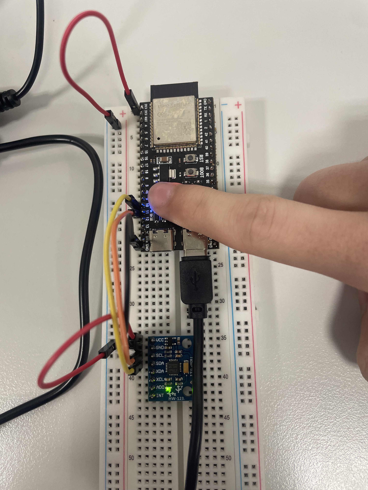

# Real-time AI on a microcontroller - breathing and motion states

MPA-PRM (Computer-Aided Medical Diagnostics), Application IV. A 4-hour graded group project:
an ESP32-S3 with an accelerometer and gyroscope that classifies what is happening to it, entirely on
the chip, and shows the result on an RGB LED, on a web page it serves itself, and on a bedside-style
monitor over Bluetooth Low Energy.

**Group members:** Kristof Krupa, Sebastian Černý (GitHub: Krecoe) <!-- TODO(fill): complete names and which member did which part -->

**Monitoring page:** TODO(fill): link, e.g. https://krecoe.github.io/<repo>/ — it must be opened in
Chrome or Edge; see [monitor/README.md](monitor/README.md).

## What it does

| LED colour | State | Meaning |
|------------|-------|---------|
| green | `calm` | calm breathing, sensor on the chest |
| red | `fast` | fast breathing, sensor on the chest |
| blue | `not_attached` | held in the hand or lying still |
| magenta | `shaking` | being shaken |

Everything after the flashing step runs on the ESP32-S3: sampling, feature extraction,
classification, smoothing and the LED. The USB cable supplies power only - no data and no
computation crosses it during a demonstration. The computer is used for training and flashing only.

## Photo of the wiring

> **TODO(fill): take this photo DURING the lab** and save it as `docs/wiring.jpg`. It is a graded
> item and it cannot be taken after the boards have been returned.

## Quick rebuild

1. Wire the sensor (4 wires, table below), power the board over USB-C.
2. `cd firmware && pio run -t upload && pio device monitor` — you should see CSV lines at 50 Hz and
   the on-board LED cycling through the four state colours.
3. Record data: `pio run -t upload && python data/record.py <label> <sessions>` — one CSV per
   session, never committed. See [docs/DATA_AND_TRAINING.md](docs/DATA_AND_TRAINING.md).
4. Train: `python training/train.py` — prints the held-out metrics and writes the model as a C
   header. See [docs/RESULTS.md](docs/RESULTS.md) for what it produced.
5. Flash the classifier firmware, unplug the data cable if you like - the board now runs alone.
6. Publish the monitoring page ([monitor/README.md](monitor/README.md)) and open it in Chrome.

Full build and flash instructions, including the COM port and library versions:
[docs/BUILD_AND_FLASH.md](docs/BUILD_AND_FLASH.md).

## Wiring

ESP32-S3 N16R8 devkit and an MPU-6050 module (our board is labelled HW-123, equivalent to GY-521).
The module has the I2C pull-ups on board, so no external resistors are needed.

| MPU-6050 / HW-123 | ESP32-S3 |
|-------------------|----------|
| VCC | 3.3 V |
| GND | GND |
| SDA | GPIO10 |
| SCL | GPIO11 |

The address is `0x68` (AD0 low, the default on these modules) and is confirmed by the I2C scan the
firmware prints at start-up. The status LED is the addressable WS2812 on **GPIO48**, driven with
`neopixelWrite()` - no external LED or resistor.

In use, hold the whole breadboard rather than the small sensor board, and press it against the chest
for the breathing classes.

## How it works

Sensor → 50 Hz sampling → sliding window → hand-made features → small classifier → smoothing → LED,
all on the board.

- Sampling: 50 Hz, ±4 g accelerometer (so shaking does not clip), ±500 °/s gyroscope, 21 Hz
  low-pass filter - below the 25 Hz Nyquist limit.
- Window: TODO(fill): length and overlap. Breathing is roughly 0.1–0.5 Hz, so a window has to cover
  several breaths.
- Features: TODO(fill): list what the final feature set actually was, per axis and magnitude.
- Model: TODO(fill): model and size as trained; see docs/DATA_AND_TRAINING.md.
- Smoothing: TODO(fill): how decisions were smoothed over time.

## Results

Numbers below are only what we measured; see [docs/RESULTS.md](docs/RESULTS.md) for the confusion
matrix and how the split was done.

| Model | Val accuracy | Notes |
|-------|--------------|-------|
| TODO(fill): baseline | TODO(fill) | TODO(fill) |
| TODO(fill): final | TODO(fill) | TODO(fill) |

On-board: TODO(fill) ms per inference, TODO(fill) RAM/ROM used.

## Repository map

| Path | What |
|------|------|
| `firmware/` | PlatformIO project (Arduino framework) - sensor, classifier, LED, web page, BLE |
| `monitor/` | Web Bluetooth monitoring page, published on GitHub Pages |
| `training/` | feature extraction, training, export of the model to C |
| `data/` | recorded CSVs - **never committed** |
| `docs/` | data and training notes, results, build instructions, BLE contract, AI-tool usage |
| `GOALS.md`, `PIPELINE.md` | task breakdown and how we planned the lab |

## AI tools

We used AI tools; which ones and for what is listed in [docs/AI_TOOLS.md](docs/AI_TOOLS.md), as the
assignment requires. Every group member can explain all committed code.

## Acknowledgements

Assignment text: https://tomasvicar.github.io/AUI-public/labs/real-time-ai.html
